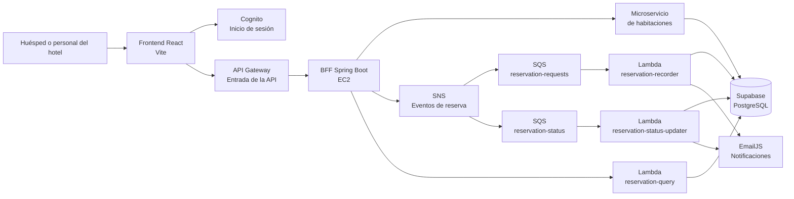

# Hotel Boutique 360

> Una experiencia sencilla para descubrir habitaciones, gestionar reservas y centralizar la operación de un hotel boutique.

## Presentación

Hotel Boutique 360 es una aplicación web pensada para reunir, en un solo lugar, la experiencia del huésped y las tareas habituales de recepción. Desde el catálogo se pueden consultar las habitaciones disponibles y solicitar una reserva; el personal autorizado puede administrar habitaciones, revisar reservas y actualizar su estado.

El proyecto está construido como una solución cloud-native: cada parte cumple una función concreta y los procesos que no necesitan una respuesta inmediata se ejecutan en segundo plano. Así, la persona recibe una confirmación rápida mientras AWS se encarga de completar el registro, actualizar la disponibilidad y enviar las notificaciones.

### Arquitectura de la solución



### El proyecto, explicado sin tecnicismos

- **El frontend** es la parte visible: catálogo, acceso, reservas, panel de operación y reportes.
- **Cognito** comprueba quién está entrando y permite diferenciar las funciones de un huésped y del personal del hotel.
- **API Gateway** es la puerta de entrada pública. Recibe las solicitudes y las dirige al sistema.
- **El BFF** coordina las operaciones: valida la sesión, consulta habitaciones y envía los eventos de reserva.
- **SNS y SQS** forman una cola de trabajo. Las reservas no dependen de que todas las tareas terminen al mismo tiempo.
- **Las Lambdas** procesan las reservas, actualizan estados y consultan la información guardada.
- **Supabase** conserva los datos y **EmailJS** se ocupa de los avisos por correo.

### Recorridos principales

#### Consultar habitaciones

```text
Frontend → API Gateway → BFF → servicio de habitaciones → Supabase
```

#### Crear una reserva

```text
Frontend → API Gateway → BFF → SNS → SQS → reservation-recorder
                                              ├─ Supabase
                                              └─ EmailJS
```

El BFF responde con `202 Accepted` cuando la solicitud quedó encolada. La reserva termina de registrarse unos segundos después.

#### Cambiar el estado de una reserva

```text
Frontend → API Gateway → BFF → SNS → SQS → reservation-status-updater
                                              ├─ Supabase
                                              └─ EmailJS
```

#### Consultar reservas

```text
Frontend → API Gateway → BFF → reservation-query → Supabase
```

## Despliegue y operación

### Qué se automatizó en GitHub

Cada repositorio conserva su propio código y workflow. Cuando se actualiza la rama principal:

1. GitHub Actions instala las dependencias y ejecuta la compilación.
2. El frontend genera sus archivos estáticos para publicación.
3. Las aplicaciones Java se empaquetan como JAR y como imagen Docker.
4. La imagen del BFF y del microservicio se publica en GitHub Container Registry.
5. El workflow se conecta a EC2 por SSH, reemplaza el contenedor anterior y levanta la nueva versión.
6. Las variables sensibles se entregan desde GitHub Secrets; no se guardan en el código.

### Qué se configuró en AWS

- **Amazon Cognito:** usuarios, inicio de sesión y grupos de acceso.
- **API Gateway HTTP API:** punto de entrada para el frontend y configuración CORS.
- **Amazon EC2:** ejecución del BFF y del microservicio mediante Docker.
- **Amazon SNS:** publicación de eventos `reservation.requested` y `reservation.status-changed`.
- **Amazon SQS:** colas que desacoplan el registro y la actualización de reservas.
- **AWS Lambda:** procesamiento asíncrono y consultas de reservas.
- **IAM/LabRole:** permisos de la EC2 y de las funciones para comunicarse con AWS.
- **Supabase PostgreSQL:** almacenamiento de habitaciones y reservas.

El frontend puede servirse como una aplicación estática en Vercel o mediante S3 + CloudFront. La guía de este repositorio documenta el despliegue con S3 + CloudFront; en ambos casos el frontend utiliza la URL pública de API Gateway.

### Resultado

La solución separa la experiencia de usuario de los procesos internos del hotel. El huésped recibe una respuesta clara, el personal trabaja con una interfaz centralizada y las tareas de persistencia y notificación se ejecutan de forma independiente y trazable en AWS.

---

## Referencia técnica

La siguiente sección conserva los detalles necesarios para configurar el entorno, comprender la seguridad y repetir el despliegue.

## 1. Objetivo

Construir una aplicación cloud native funcional y segura que permita:

- Iniciar y cerrar sesión con Cognito.
- Obtener tokens mediante Authorization Code con PKCE.
- Leer los claims del token, incluyendo grupos o roles.
- Consultar el estado del backend mediante `/health`.
- Consultar y administrar habitaciones mediante el CRUD del backend.
- Proteger las operaciones administrativas con el rol `ADMIN`.
- Ejecutar el backend en EC2 mediante Docker y GitHub Actions.
- Persistir la información en Supabase PostgreSQL.

## 2. Tecnologías

### Frontend

- React 19.
- TypeScript.
- Vite.
- `react-oidc-context` y `oidc-client-ts` para OIDC.
- Axios para consumir el API Gateway.
- `lucide-react` para iconos.

### Backend

- Java 21.
- Spring Boot.
- Spring Security.
- OAuth2 Resource Server con JWT.
- Spring Data JPA.
- PostgreSQL mediante Supabase.
- Docker.

### Nube y entrega

- Amazon Cognito como proveedor de identidad.
- AWS API Gateway como API Manager.
- Amazon EC2 para ejecutar el backend.
- Amazon SNS y SQS para procesar reservas de forma asíncrona.
- AWS Lambda para registrar, consultar y actualizar reservas.
- Supabase como base de datos PostgreSQL.
- GitHub Container Registry para publicar la imagen Docker.
- GitHub Actions para compilar, publicar y desplegar.

## 3. Estructura del proyecto

```text
frontend-hotelboutique360/
  src/
    api/axiosInstance.ts       # Cliente Axios y header Authorization
    config/authConfig.ts       # Configuración OIDC y URL del API
    components/
      Navbar.tsx
      RoleGuard.tsx             # Protección visual por rol
      Sidebar.tsx
    views/
      DashboardView.tsx
      RoomsView.tsx             # CRUD conectado al backend
      ReservationsView.tsx
      Reportsview.tsx
    types/index.ts
    utils/authUtils.ts          # Lectura de grupos del JWT
  .env.local                   # No se versiona
  package.json

ms-hotel-rooms/
  src/main/java/
    .../controller/RoomController.java
    .../health/HealthCheckController.java
    .../config/SecurityConfig.java
    .../config/SecretGatewayFilter.java
    .../security/CognitoJwtAuthenticationConverter.java
  src/main/resources/application.properties
  Dockerfile
  .github/workflows/deploy.yml
```

## 4. Configuración de Cognito

Amazon Cognito administra el tenant de identidad, los usuarios, el inicio de sesión y los grupos utilizados como roles.

### 4.1 User Pool

El backend valida tokens emitidos por el User Pool configurado mediante su issuer:

```text
https://cognito-idp.<region>.amazonaws.com/<user-pool-id>
```

En el proyecto, este valor se configura en `VITE_COGNITO_AUTHORITY` para el frontend y en `spring.security.oauth2.resourceserver.jwt.issuer-uri` para Spring Boot.


### 4.2 Usuarios y roles

| Usuario | Grupo Cognito | Propósito |
|---|---|---|
| Usuario administrador | `ADMIN` | Crear, editar y eliminar habitaciones |
| Usuario huésped o recepción | `HUESPED` o `RECEPCIONISTA` | Consultar el catálogo |

El grupo debe llamarse exactamente `ADMIN`, porque el backend lo transforma en la autoridad `ROLE_ADMIN`.


### 4.3 Aplicación SPA

Registrar una aplicación pública tipo SPA sin client secret para el frontend.

Configuración de prueba local:

```text
Callback URL:
http://localhost:5173
```

Scopes utilizados:

```text
openid
email
phone
```

Flujo OAuth:

```text
Authorization Code Grant con PKCE
```


### 4.4 Configuración del frontend

Crear `.env.local` en desarrollo o configurar las variables equivalentes en el entorno de despliegue del frontend:

```env
VITE_COGNITO_AUTHORITY=https://cognito-idp.<region>.amazonaws.com/<user-pool-id>
VITE_COGNITO_CLIENT_ID=<app-client-id>
VITE_API_URL=https://<api-id>.execute-api.<region>.amazonaws.com
```

## 5. Implementación del frontend

### 5.1 Autenticación OIDC

`AuthProvider` envuelve la aplicación y administra:

- Redirección al login de Cognito.
- Recuperación del código de autorización.
- Intercambio mediante PKCE.
- Estado de autenticación.
- Cierre de sesión.
- Renovación y almacenamiento de la sesión OIDC.

La configuración utiliza:

```ts
response_type: 'code'
scope: 'openid email phone'
redirect_uri: window.location.origin
```


### 5.2 Claims y control por rol

El frontend lee el claim:

```text
cognito:groups
```

El componente `RoleGuard` limita visualmente el acceso a las vistas administrativas. Por ejemplo, la vista de reportes permite únicamente el grupo `ADMIN`.

Esta protección visual mejora la experiencia, pero la seguridad real también se aplica en Spring Security mediante `@PreAuthorize`.


### 5.3 Header JWT

El cliente Axios agrega el token en las peticiones salientes:

```http
Authorization: Bearer <id_token>
```

El frontend nunca maneja secretos de infraestructura. Las rutas privadas de reservas se validan con el JWT en el BFF. Las operaciones de habitaciones conservan además la protección interna `X-Secret-Gateway`, gestionada entre API Gateway y el BFF.

## 6. API Manager: AWS API Gateway

API Gateway funciona como intermediario entre el frontend y el backend.

### 6.1 Rutas

La API se publica mediante una ruta catch-all:

```text
ANY /api/{proxy+}
```

El BFF decide qué operaciones son públicas y cuáles requieren autenticación:

| Método | Ruta API Gateway | Integración backend | Protección |
|---|---|---|---|
| GET | `/api/health` | `/api/health` | Pública |
| GET | `/api/v1/rooms` | `/api/v1/rooms` | Pública para catálogo |
| GET | `/api/v1/rooms/{id}` | `/api/v1/rooms/{id}` | Pública para catálogo |
| POST | `/api/v1/rooms` | `/api/v1/rooms` | JWT + `ADMIN` |
| PUT | `/api/v1/rooms/{id}` | `/api/v1/rooms/{id}` | JWT + `ADMIN` |
| DELETE | `/api/v1/rooms/{id}` | `/api/v1/rooms/{id}` | JWT + `ADMIN` |
| POST | `/api/v1/reservations` | `/api/v1/reservations` | JWT |
| GET | `/api/v1/reservations` | `/api/v1/reservations` | JWT |
| PATCH | `/api/v1/reservations/{id}/status` | `/api/v1/reservations/{id}/status` | JWT + personal autorizado |

El `OPTIONS` de las rutas se permite para resolver el preflight CORS. La operación real continúa protegida por JWT.


### 6.2 JWT Authorizer

El Authorizer debe validar como mínimo:

- `issuer` correspondiente al User Pool.
- Firma del JWT mediante las claves públicas de Cognito.
- Expiración del token.
- Tipo de token y claims requeridos.
- Audience o Client ID, según la configuración del API Gateway y el tipo de token utilizado.


### 6.3 CORS

Para desarrollo local permitimos el origen real del frontend:

```text
http://localhost:5173
```

En producción se debe reemplazar por el dominio real del frontend. Configurar únicamente los métodos y headers necesarios:

```text
Métodos: GET, POST, PUT, DELETE, OPTIONS
Headers: Authorization, Content-Type
```

No se deben permitir orígenes arbitrarios con `*` cuando se presenta la configuración de producción.


## 7. Backend Spring Boot en EC2

### 7.1 Seguridad

Spring Boot funciona como Resource Server OAuth2 y valida el JWT de Cognito. El conversor de autenticación lee `cognito:groups` y crea autoridades con el prefijo `ROLE_`.

Ejemplo:

```text
Grupo Cognito: ADMIN
Autoridad Spring: ROLE_ADMIN
Regla: hasRole('ADMIN')
```

Las operaciones administrativas del controlador de habitaciones están protegidas con:

```java
@PreAuthorize("hasRole('ADMIN')")
```

Además, el filtro `SecretGatewayFilter` exige el header interno para las operaciones de habitaciones:

```http
X-Secret-Gateway: <secreto configurado en GitHub Actions>
```

Las rutas de reservas no dependen de ese secreto; se protegen mediante el JWT y publican sus eventos en SNS.


### 7.2 Persistencia

El backend utiliza entidades JPA, repositorios y PostgreSQL en Supabase. Las variables se inyectan desde GitHub Actions al contenedor:

```text
DB_URL
DB_USER
DB_PASSWORD
```

La base de datos contiene la entidad `Room`, con campos como:

- Identificador UUID.
- Número de habitación.
- Tipo.
- Precio por noche.
- Disponibilidad.
- Descripción.
- URL de imagen.


## 8. Despliegue mediante GitHub Actions

El workflow realiza estas etapas:

1. Descarga el código.
2. Configura Java 21.
3. Construye el JAR con Gradle.
4. Construye la imagen Docker.
5. Publica la imagen en GHCR.
6. Se conecta a EC2 mediante SSH.
7. Instala Docker si es necesario.
8. Descarga la imagen publicada.
9. Detiene y reemplaza el contenedor anterior.
10. Inyecta las variables de entorno.
11. Ejecuta el BFF en EC2 con Docker y conecta el servicio de habitaciones en la red interna de la instancia.

Secrets requeridos en GitHub:

```text
EC2_SSH_KEY
GH_CR_PAT
API_GATEWAY_SECRET
SUPABASE_DB_USER
SUPABASE_DB_PASSWORD
```

Variables de repositorio:

```text
TARGET_HOST_IP
```


## Gracias por dedicar tiempo a leer!